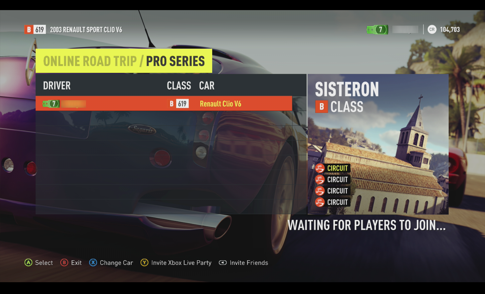

# FH2Revival v1.0.48

FH2Revival is a community project that restores Online Road Trip functionality to Forza Horizon 2 on Xbox 360.

The project consists of an Xbox 360 DashLaunch plugin and a custom replacement for the retired Turn 10 title-server services used by the game.

## Current Status

FH2Revival v1.0.48 currently supports:

- Online Road Trip
- Native playlist matchmaking
- Destination Vote
- Amateur Series
- Pro Series
- Pure Skill
- Playground
- Free Roam
- Clubs
- Speed trap leaderboards
- Players on unmodded consoles can join a lobby hosted by someone running the plugin

## Requirements

- Xbox 360 with RGH, JTAG, BadUpdate or PeerPressure
- DashLaunch
- Forza Horizon 2 for Xbox 360
- Title Update 9 (TU09)
- Xbox Live connectivity
- `FH2Revival.xex`

## Installation

1. Download `FH2Revival.xex` from the latest GitHub Release.
2. Copy it somewhere on your Xbox 360 storage device.
3. Add `FH2Revival.xex` as a DashLaunch plugin and enable sockpatch.
4. Save your DashLaunch configuration.
5. Reboot the console.
6. Launch Forza Horizon 2 with TU09 installed.

## Known Limitations

- Players on unmodded consoles see a "Server not available" message about XP after each Online Road Trip event. XP and levelling still work locally.
- Rivals is not currently supported but support is planned for a future release.

## Credits

### FH2Revival

- **Claude** - reverse engineering, plugin/server development assistance, debugging and research.
- Community testers who helped verify multiplayer functionality and compatibility.

### Sunrise

FH2Revival is derived from the Halo Sunrise 2.0 plugin.

- **Byrom** - Sunrise2 plugin
- **craftycodie** - Halo hooks and addresses
- **FreestyleDash Team** - xkelib
